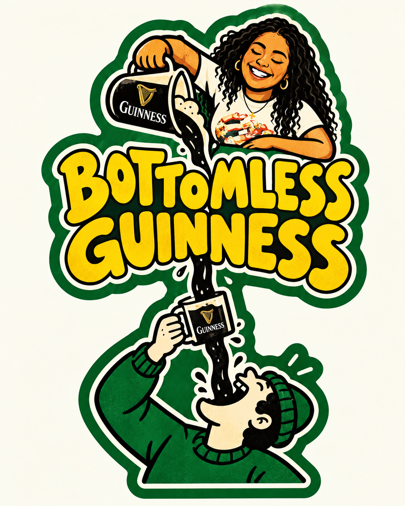

# Guinness sticker

- [Open the original PNG](guinness-sticker.png)
- [Download ZIP](guinness-sticker.zip?raw=true)

The ZIP includes the original PNG, a vectorized SVG, a PNG rendered from that SVG,
Python source, dependency versions, reproduction instructions, and SHA-256 hashes.
The Python source vectorizes the supplied image; it does not draw the original
illustration from scratch. Reproduction also requires Inkscape.
